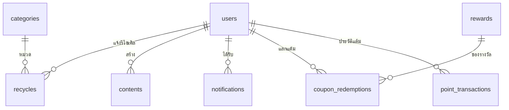

# GreenLoop

เว็บแอปพลิเคชัน Green Digital สำหรับแจ้งรีไซเคิลขยะอิเล็กทรอนิกส์ ติดตามผลลด CO₂e และรับแต้มสะสมเพื่อเลื่อนระดับ
พร้อมระบบแจ้งเตือนทั้งฝั่งสมาชิกและผู้ดูแล

เขียนให้สั้นและจำง่ายสำหรับซ้อมแข่ง: **ระบบ PHP + MySQL (8 ตาราง) + CSS**
ใช้ PHP + MySQL + Bootstrap 5 + Chart.js และ JavaScript บน XAMPP

แผนซ้อมแข่ง 7 + 1 ชั่วโมง: [docs/PRACTICE_PLAN.md](docs/PRACTICE_PLAN.md)

## ติดตั้ง

1. คัดลอกโฟลเดอร์นี้ไปไว้ที่ `C:\xampp\htdocs\greenloop`
2. phpMyAdmin → Import → `database.sql` (ไฟล์นี้ลบแล้วสร้างฐานข้อมูล `greenloop` ใหม่พร้อมข้อมูลตัวอย่าง; หากมีฐานข้อมูลเดิมที่ต้องการเก็บ ให้สำรองข้อมูลก่อน)
3. เปิด `http://localhost/greenloop/`

โปรเจกต์นี้ใช้ `database.sql` สำหรับติดตั้งใหม่ ไฟล์นี้ลบและสร้างฐานข้อมูล `greenloop` ใหม่ จึงไม่ควรนำเข้าเพื่ออัปเดตฐานข้อมูลเดิมที่มีข้อมูลสำคัญ หากมีฐานข้อมูลเดิม ให้สำรองข้อมูลแล้วนำเข้า `migration_remove_upload_fields.sql` เพื่อลบคอลัมน์เก็บรูปโปรไฟล์และรูปสินค้า

| บทบาท                                            | อีเมล                  | รหัสผ่าน  |
| ------------------------------------------------ | ---------------------- | --------- |
| ผู้ดูแลระบบ                                      | admin@greenloop.local  | admin1234 |
| สมาชิก (มีคำขอรีไซเคิลและแจ้งเตือนที่ยังไม่อ่าน) | demo@greenloop.local   | demo1234  |
| สมาชิก (มีคำขอรีไซเคิลรอตรวจรับ)                 | wichai@greenloop.local | demo1234  |

บัญชีตัวอย่างทุกบัญชีใช้คำถามกันลืม "ชื่อสัตว์เลี้ยงตัวแรกของคุณ" คำตอบคือ `greenloop`

## โครงสร้างไฟล์

```
init.php        ส่วนกลาง: ฐานข้อมูล ตัวช่วย สิทธิ์ แจ้งเตือน โครงหน้าเว็บ
database.sql    ส่วนกลาง: โครงสร้าง 8 ตาราง + ข้อมูลตัวอย่าง
assets/         ส่วนกลาง: Bootstrap 5, Chart.js และ style.css
migration_remove_upload_fields.sql  คำสั่งลบคอลัมน์รูปออกจากฐานข้อมูลเดิม
*.php           หน้าบ้าน: หน้าเว็บสำหรับผู้เยี่ยมชมและสมาชิก
admin/*.php     หลังบ้าน: หน้าเว็บสำหรับผู้ดูแลระบบ
```

### ส่วนกลาง

| ไฟล์           | บรรทัด | เกณฑ์ที่ตอบ                                                                  |
| -------------- | ------ | ---------------------------------------------------------------------------- |
| `database.sql` | —      | งานฐานข้อมูล: 8 ตาราง PK FK ชนิดและขนาดข้อมูล                                |
| `init.php`     | —      | Session, ตรวจสิทธิ์ทุกหน้า, Role-based access, Validate, Responsive (navbar) |

### หน้าบ้าน (ผู้เยี่ยมชมและสมาชิก)

| ไฟล์                     | บรรทัด | เมนู                     | เกณฑ์ที่ตอบ                                                                                |
| ------------------------ | ------ | ------------------------ | ------------------------------------------------------------------------------------------ |
| `index.php`              | 63     | หน้าแรก                  | ส่วนต้อนรับ ขั้นตอนใช้งาน ผลกระทบรวม ข่าวสารตามเวลาเปิด-ปิด, ค้นหา                         |
| `login.php` `logout.php` | 29     | เข้าสู่ระบบ / ออกจากระบบ | Login - Logout, เข้ารหัสรหัสผ่าน (`password_verify`)                                       |
| `register.php`           | 34     | สมัครสมาชิก              | สมัครสมาชิก เลือกคำถามกันลืมและตั้งคำตอบ, Validate, แจ้งเตือนสมาชิกใหม่                     |
| `forgot.php`             | 23     | ลืมรหัสผ่าน              | ยืนยันด้วยอีเมล คำถามที่เลือกไว้ และคำตอบ แล้วตั้งรหัสผ่านใหม่                             |
| `profile.php`            | 42     | โปรไฟล์                  | แก้ไขข้อมูลโปรไฟล์และรหัสผ่าน                                                              |
| `recycle.php`            | —      | รีไซเคิล                  | ประเมิน CO₂e จากหมวดและน้ำหนัก แจ้งรีไซเคิล ติดตามสถานะ ค้นหา เรียงลำดับ                    |
| `points.php`             | 48     | แต้มของฉัน               | แรงจูงใจ: แต้ม ระดับสมาชิก อันดับ                                                          |
| `coupons.php`            | —      | แลกคูปอง                 | ใช้แต้มส่งคำขอแลกของรางวัล ดูสถานะและรหัสคูปองที่อนุมัติแล้ว                               |
| `notifications.php`      | 30     | 🔔                       | การแจ้งเตือนของผู้ใช้ปัจจุบัน ใช้ร่วมกันทั้งสมาชิกและผู้ดูแล                               |

### หลังบ้าน (ผู้ดูแลระบบ)

| ไฟล์                 | บรรทัด | เมนู          | เกณฑ์ที่ตอบ                                                       |
| -------------------- | ------ | ------------- | ----------------------------------------------------------------- |
| `admin/index.php`    | 38     | Dashboard     | ตัวเลขสรุป 8 ช่อง กราฟ 3 ชุด แจ้งเตือนและอนุมัติคำขอคูปองล่าสุด  |
| `admin/users.php`    | 29     | สมาชิก        | จัดการสมาชิก: ค้นหา ระงับสิทธิ์                                   |
| `admin/contents.php` | 55     | เนื้อหา       | เพิ่ม ลบ แก้ไข ค้นหา ตั้งเวลาเปิด-ปิด                             |
| `admin/green.php`    | 65     | ตั้งค่า Green | จัดการหมวดขยะและค่า CO₂e ที่ลดได้ต่อกิโลกรัม                       |
| `admin/recycles.php` | 51     | รีไซเคิล      | Green ฝั่งผู้ดูแล 2: ตรวจรับด้วยน้ำหนักจริง ให้แต้มและ CO₂e      |
| `admin/coupons.php`  | —      | คูปอง         | จัดการของรางวัล กำหนดแต้ม อนุมัติ/ไม่อนุมัติคำขอและออกคูปอง     |
| `admin/reports.php`  | 71     | รายงาน        | รายงานสมาชิก เนื้อหา Green: กรอง ค้นหา กราฟ พิมพ์ ส่งออก CSV      |

### คูปองแลกของรางวัล

- ผู้ดูแลจัดการของรางวัล แต้มที่ใช้ สต็อก และอายุคูปอง 1-365 วันในเมนู "คูปอง"
- ตอนผู้ใช้ขอแลก ระบบหักแต้มและจองสต็อก; หากผู้ดูแลไม่อนุมัติจะคืนทั้งแต้มและสต็อก
- เมื่ออนุมัติ ระบบออกโค้ดเฉพาะรายการพร้อมวันหมดอายุ ผู้ใช้กรอกโค้ด ชื่อผู้รับ เบอร์โทร และที่อยู่เพื่อใช้คูปองรับของ
- โค้ดใช้ได้ครั้งเดียว; คำขอที่ผู้ใช้ส่งข้อมูลจัดส่งแล้วจะแสดงใน Dashboard/หน้าจัดการคูปองให้แอดมินดำเนินการส่งของ
- ประวัติแต้มเข้า-ออกแสดงในหน้า "แลกคูปอง"; การติดตั้งกับฐานข้อมูลเดิมเริ่มบันทึกประวัติตั้งแต่วันที่อัปเกรด โดยเก็บแต้มคงเหลือเดิมเป็นยอดตั้งต้น

## ฟีเจอร์หลัก

### รีไซเคิลขยะอิเล็กทรอนิกส์

- เลือกหมวดและกรอกน้ำหนักเพื่อประเมิน CO₂e ที่คาดว่าจะลดได้ จากนั้นส่งคำขอและติดตามสถานะในหน้า `recycle.php`
- ค่าประมาณคำนวณจากน้ำหนัก × ค่า CO₂e ต่อกิโลกรัมของหมวด; ผลจริงบันทึกเมื่อผู้ดูแลตรวจรับด้วยน้ำหนักจริง
- แต้มรีไซเคิล = น้ำหนักที่ชั่งจริง × 20

### การแจ้งเตือน

`notify($to, $title, $msg, $link)` โดย `$to` คือ id ของสมาชิกผู้รับ หรือ `null` เมื่อส่งถึงผู้ดูแลระบบ

| เหตุการณ์                    | แจ้งใคร                                  |
| ---------------------------- | ---------------------------------------- |
| สมัครสมาชิกใหม่              | ผู้ดูแล และข้อความต้อนรับถึงสมาชิกคนนั้น |
| สมาชิกส่งคำขอรีไซเคิล        | ผู้ดูแล                                  |
| ผู้ดูแลตรวจรับหรือปฏิเสธคำขอ | สมาชิก                                   |

ตัวเลขที่กระดิ่งบนแถบเมนูคือจำนวนที่ยังไม่อ่าน เปิดหน้าแจ้งเตือนแล้วถือว่าอ่านทั้งหมด

## ทุกหน้าใช้โครงเดียวกัน 4 ขั้น

```php
<?php
require 'init.php';              // 1. โหลดแกนกลาง (หน้าใน admin/ ใช้ '../init.php')
$u = need_login();               // 2. ตรวจสิทธิ์: need_login() หรือ need_admin()

if ($_POST) {                    // 3. บันทึกข้อมูล แล้ว go() ไปหน้าเดิมพร้อมข้อความ
    q('INSERT ...', [p('name')]);
    go('page.php', 'บันทึกแล้ว');
}

$rows = all('SELECT ...');       // 4. ดึงข้อมูล แล้วแสดงผลระหว่าง head() กับ foot()
head('ชื่อหน้า');
?>
... HTML ...
<?php foot() ?>
```

## ฟังก์ชันใน `init.php` ที่ต้องจำ

| กลุ่ม        | ฟังก์ชัน                                  | ใช้ทำอะไร                                                           |
| ------------ | ----------------------------------------- | ------------------------------------------------------------------- |
| ฐานข้อมูล    | `q` `all` `one` `val`                     | รันคำสั่ง, หลายแถว, แถวเดียว, ค่าเดียว (prepared statement ทั้งหมด) |
| รับค่า       | `g('q')` `p('name')` `like()`             | ค่าจาก GET, ค่าจาก POST, คำค้นแบบ `%คำ%`                            |
| แสดงผล       | `e` `dt`                                  | กันโค้ดแปลกปลอมก่อนแสดง, จัดรูปแบบวันเวลา                           |
| เปลี่ยนหน้า  | `go($url, $msg, $type)` `flash`           | redirect พร้อมข้อความแจ้งผล                                         |
| สิทธิ์       | `me` `need_login` `need_admin`            | ผู้ใช้ปัจจุบัน, บังคับเข้าสู่ระบบ, บังคับเป็นผู้ดูแล                |
| ตรวจข้อมูล   | `check_user` `check_pass`                 | คืนข้อความผิดพลาด หรือ `''` เมื่อถูกต้อง                            |
| แจ้งเตือน    | `notify` `inbox`                          | ส่งแจ้งเตือน, กล่องแจ้งเตือนของผู้ใช้ปัจจุบัน                       |
| ชิ้นส่วนหน้า | `input` `question` `box` `search` `chart` | ช่องกรอก, ช่องเลือกคำถามกันลืม, กล่องตัวเลขสรุป, ช่องค้นหา, กราฟ    |
| โครงหน้า     | `head($title, $show)` `foot`              | ส่วนหัวและท้ายของทุกหน้า                                            |
| อื่น ๆ       | `level`                                   | ระดับสมาชิกจากแต้ม                                                  |

เทคนิคที่ทำให้โค้ดสั้น:

- **ค้นหา:** ใช้ `WHERE name LIKE ?` กับ `like()` เสมอ คำค้นว่างจะกลายเป็น `%%` ซึ่งตรงกับทุกแถว จึงไม่ต้องเขียน if
- **กรอง:** ใช้ `AND (? = '' OR status = ?)` และช่วงวันที่มีค่าเริ่มต้น 2000-01-01 ถึง 2100-01-01
- **หลายปุ่มในฟอร์มเดียว:** ตั้ง `name` ให้ปุ่ม แล้วตรวจด้วย `isset($_POST['delete'])`
- **เพิ่มและแก้ไขใช้ฟอร์มเดียว:** ช่อง `id` ว่าง = เพิ่ม, มีค่า = แก้ไข
- **แจ้งเตือนของผู้ดูแลกับสมาชิกใช้ตารางและหน้าเดียวกัน:** `WHERE user_id <=> ?` โดย `<=>` เทียบค่า `NULL` ได้

## ฐานข้อมูล 8 ตาราง



## กติกาของระบบ

- รีไซเคิล: แต้ม = น้ำหนักที่ชั่งจริง × 20, คาร์บอนที่ลดได้ = น้ำหนัก × ค่าของหมวด
- ระดับสมาชิก: เมล็ดพันธุ์ → ต้นกล้า (100) → ต้นไม้ (300) → Net Zero Hero (600)
- ค่า CO₂e ต่อกิโลกรัมของแต่ละหมวดเป็นค่าประมาณสำหรับสาธิต ผู้ดูแลแก้ได้ที่เมนู "ตั้งค่า Green"

## สิ่งที่ไม่มีในระบบนี้

ตลาดสินค้ามือสอง, ของรางวัล, CSRF token, หมดเวลา session อัตโนมัติ
ระบบนี้เขียนเพื่อการแข่งขันและการสาธิต ควรเพิ่มการป้องกันเหล่านี้ก่อนนำไปใช้งานจริง
